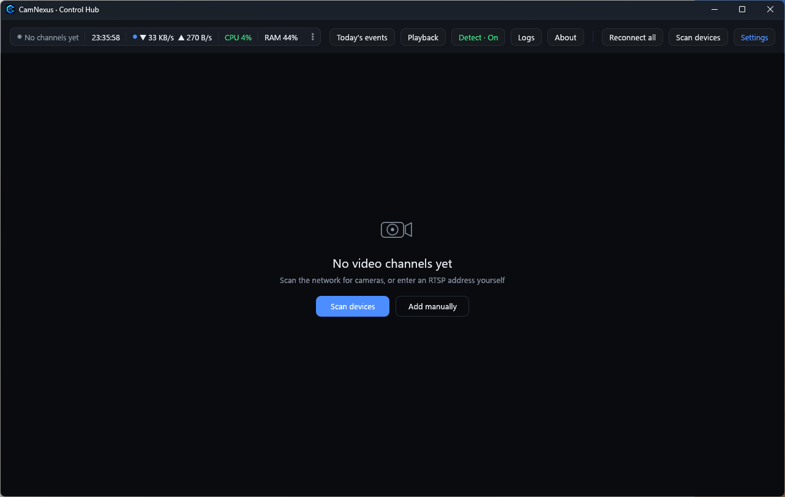
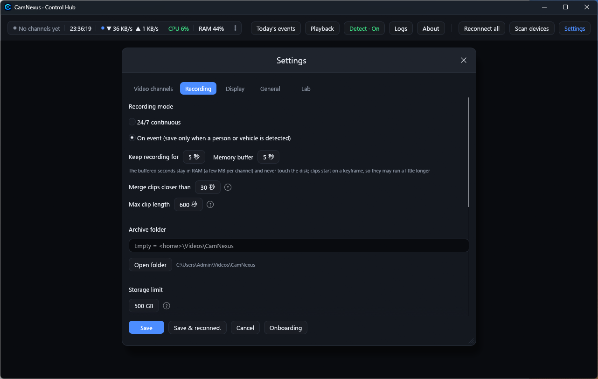
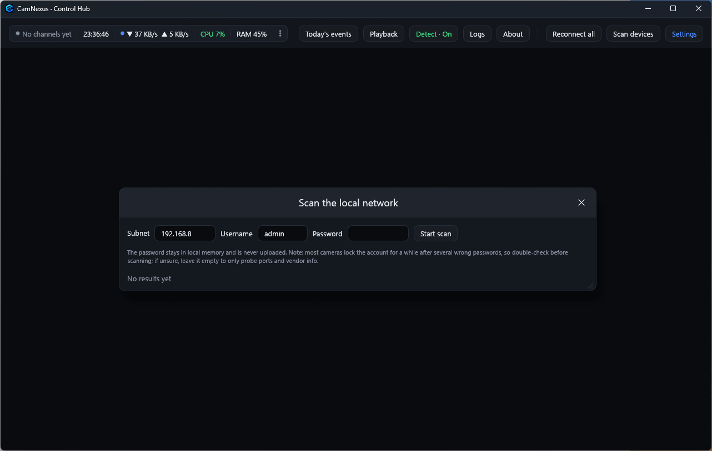
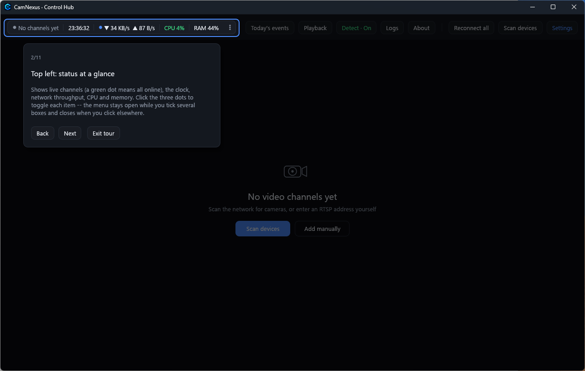

# CamNexus

> All your LAN cameras in one window — watch, record, play back.
> Built for old PCs: no transcoding, low memory, works out of the box.

**English | [简体中文](README.md)**

---

## What it is

CamNexus is a Windows desktop app for watching and recording cameras on your local network.

Any device that exposes an **RTSP address** can be added — IP cameras, NVRs, even a phone running a camera app. There is no vendor cloud involved: video and recordings stay on your own machine.

The goal is simple: **turn an old PC into a surveillance recorder**. That's why it records the original stream without re-encoding, renders with a lightweight UI, and keeps memory in the low hundreds of megabytes.

---

## Screenshots

| | |
|---|---|
|  |  |
|  |  |

---

## Features

### Watching

- **Many cameras at once** — any number of channels, arranged in a grid
- **Free-form fullscreen layout** — drag, resize and snap each view; positions are remembered
- **Auto layout** — tidy scattered views into an even grid
- **Single-channel fullscreen** — double-click or use the right-click menu
- **Sub-stream support** — main stream for big views, sub-stream for small ones
- **Audio** — enable sound for any individual channel; it rides on the same connection as the picture, so it costs no extra camera session
- **Hardware decoding** — CUDA / D3D11VA / QSV / AMF, handing decoding to the GPU
- **Data bar** — the top bar shows live channels, clock, network throughput, CPU and memory; click the ⋮ at its right edge to choose which of them appear

### Recording & playback

- **Records the original stream** — the camera's own bitstream is packaged into MP4, no re-encoding, near-zero CPU
- **Hourly segments** — organised by channel and date; files are cut on the hour with seconds in the name, so a retry can never overwrite the previous one
- **Recovers on its own** — network failures are retried indefinitely (30 s ceiling). Power loss, a switch reboot or a camera restart all heal by themselves
- **Records only when there is a picture** — an offline camera never starts a segment, so no empty files and no wasted retries
- **Storage cap** — 500 GB by default; the oldest files are deleted first, and the cap never exceeds the free disk space
- **Event recording** — records only when someone or something is there, writing nothing while idle; see [below](#event-recording-optional)
- **Playback** — built-in player, browsable by date and channel
- **Snapshots** — save the current frame as an image

### Unattended operation

- **Start with Windows** — launches after you sign in; written to the current user's startup entries, no admin rights needed
- **Process watchdog** — relaunches the app if it crashes, and exits together with it when you close the window
- **Record on launch** — goes straight into recording at boot; channels that are not online yet start as soon as they connect

> The watchdog depends on the startup entry: enabling it without startup would leave nothing to launch it after a reboot, so the two are linked in Settings.

### Image adjustments

- **Rotate / flip** — 0° / 90° / 180° / 270°, horizontal and vertical flips
- **Trim black borders** — detects and removes the pure-black padding baked into a stream (common with portrait phone streams)
- **Aspect lock** — keep proportions while resizing; unlock to stretch freely
- **Restore original ratio** — put the view back to the picture's own aspect

### Discovery & connection

- **LAN scan** — finds candidate cameras and open ports on your subnet
- **Address probing** — tries common RTSP paths and reports working URLs
- **Connection diagnostics** — frame rate, stall reason and status for each channel

### Interface

- Simplified Chinese / English, **selectable on the first screen of the tour** — the rest of the guide follows immediately
- Dark and light themes
- An 11-step guided tour on first run, from the data bar down to the recording modes; replay it any time from the button at the bottom of Settings
- Configurable data bar: tick as many items as you like — the menu stays open until you click elsewhere

### Experimental (off by default)

- **Person / vehicle detection** — draws boxes on the picture, but only around targets that are **moving**: a parked car or someone standing still will not keep a box.
  The toggle is remembered: after a restart — or a crash the watchdog recovers from — detection comes back the way you left it, so event recording keeps working.
  It needs a separate model download, runs on CPU or GPU, and samples at 1–25 FPS (10 on CPU, 25 on GPU) with an on-screen load estimate; it is heavy for older machines, so it stays off unless you turn it on.
- **Boxes and triggers are not the same thing**: only moving targets get a box, but event recording is looser — a person counts while present (even standing still), while vehicles and bikes have to be moving.

---

## Requirements

| | |
|---|---|
| OS | Windows 10 / 11 (64-bit) |
| CPU | Dual-core is enough; four cores or more for several 1080p streams |
| RAM | 2 GB or more |
| GPU | Not required; integrated or discrete graphics can enable hardware decoding |
| Network | Same LAN as the cameras |

**FFmpeg is not required up front** — the app downloads it on first launch, hashing the bytes with SHA-256 as they arrive and only keeping the file once it matches, then runs `-version` to confirm it starts. It lives under `%LOCALAPPDATA%\CamNexus`.

> FFmpeg is invoked as a **separate process**: it is not linked, not bundled and not distributed with this app. It is published under GPLv3, copyright the FFmpeg authors, source at [ffmpeg.org](https://ffmpeg.org).

---

## Getting started

1. **Download and unzip** to any folder (avoid paths that need administrator rights)
2. **Run** `camnexus.exe`. On first launch it offers to download FFmpeg — let it finish
3. **Add a channel**: top bar → Settings → Channels → enter the address, username and password
   - Not sure about the address? Click **Scan** and the app will look for cameras on your subnet
4. **Save and go back** — the picture appears

> A typical camera address looks like `rtsp://192.168.1.10:554/Streaming/Channels/101`.
> Enter credentials in the separate fields, not inside the URL.

---

## A quick look at the UI

```
┌──────────────────────────────────────────────────────────────────────┐
│ ● 2/2 online │ 10:42:07 │ ▼2.3 MB/s ⋮   Today Playback … Settings    │
├──────────────────────────────────────────────────────────────────────┤
│ ┌───────────┐ ┌───────────┐                                          │
│ │ Channel 1 │ │ Channel 2 │                                          │
│ └───────────┘ └───────────┘                                          │
└──────────────────────────────────────────────────────────────────────┘
```

| What you want | Where |
|---|---|
| Add or edit channels | Top bar → Settings → Channels |
| Recording options, storage cap | Top bar → Settings → Recording |
| Resolution, decoding, theme, language | Top bar → Settings → Display / General |
| Start with Windows, watchdog, record on launch | Top bar → Settings → General → Startup & runtime |
| Which metrics the data bar shows | ⋮ at the right edge of the data bar |
| Browse recordings | Top bar → Playback |
| Zoom one channel | Double-click it |
| Enter / leave fullscreen | Bottom-right button; `Esc` to exit |

### Right-click menu

Right-click any view to adjust that channel:

```
Picture
  ├ Rotation (preview)   0° / 90° / 180° / 270°
  ├ Flip horizontally
  ├ Flip vertically
  ├ Lock aspect ratio
  ├ Trim black borders
  └ Restore original ratio
──────────────
View
  ├ Auto layout
  └ Fullscreen this channel
──────────────
Actions
  ├ Snapshot
  └ Reconnect
```

> Rotation and flipping affect the **preview only** — recordings always keep the camera's original picture.

---

## Recording and storage

| | Default | Notes |
|---|---|---|
| Location | `Videos\CamNexus` | Can be changed to any disk in Settings |
| Storage cap | 500 GB | Oldest files are removed first; set 0 for no limit |
| Mode | Original stream (no re-encode) | Near-zero CPU, identical to the camera's own quality |
| Audio | On | The camera's microphone or audio track is stored in the MP4 |
| Segments | Hourly | One file per hour, named `date start-end`; a retry never overwrites an earlier file |

Files are organised as `channel / date / time`, and can be opened with any media player — no dependency on this app.


### Event recording (optional)

The default is **24/7 continuous recording**. Settings → Recording → Recording mode also offers **on event**:

- the camera stays connected, but the picture only lives in **memory** for the last few seconds (5 by default) and is never written to disk
- two kinds of trigger: a **person** counts the moment they appear, even standing still; **vehicles and bikes** have to actually move (8% of the frame width per second). Detection boxes jitter by 1–2% on a parked car, so "record whatever is detected" would run all night
- the seconds around the trigger are saved, and two clips less than 30 seconds apart are joined into one file (adjustable, 0 disables joining)
- one clip is capped at 10 minutes; it closes there rather than running forever because someone lingers
- writing stops as soon as the trigger ends — the file handle stays open for a possible continuation, so the idle time never reaches the file
- clips start on a keyframe, so the "5 seconds before" may run a little longer
- detection must be enabled first; without it, event recording never triggers
- clips live in `事件片段/date/channel/`, **kept apart from the continuous recordings**; the replay window switches between the two

The upside is no disk writes while idle, which suits both spinning disks and SSDs.
The trade-off: it depends on detection accuracy. If you would rather miss nothing, stay on 24/7.

---

## Companion app

### CamNexusRTSP — turn an Android phone into a camera

Got a spare Android phone? Install [CamNexusRTSP](https://github.com/oywq00008-cell/CamNexus-RTSP): it runs an RTSP server on the phone itself and streams the camera straight onto your LAN — no PC relay, no cloud.

- A phone camera usually looks far better than a budget IP camera
- Standard RTSP output, so you can add it here as a channel directly
- Keeps streaming in the background and while locked; optional credentials; port 8554 by default

> To connect: start streaming on the phone, then paste the `rtsp://phone-ip:8554/...` address shown there into **Settings → Channels**.

---

## FAQ

**No sound?**

Run `camnexus.exe --audio-test 1` (the number is the channel index). It reports whether the channel carries an audio track and whether samples actually arrive — enough to tell "this camera has no microphone" apart from "the stream failed".

**A camera won't connect.**

Check three things: the address is complete, the credentials are correct, and RTSP is enabled on the device. On Hikvision and Dahua devices the *device account* and the *ONVIF account* are separate — being able to log into the web UI does not mean RTSP will accept the same login.

**The picture is a narrow strip with black bars.**

The stream itself is probably portrait video padded into a landscape frame. Right-click → **Trim black borders**, then rotate 90°.

**Does it recover after a power cut or a network drop?**

Yes. Streams reconnect with a 1→2→4→8→10 second backoff, and recording retries network errors indefinitely with a 30 second ceiling, resuming as soon as the camera is back. With **start with Windows + process watchdog** enabled, the app itself comes back after a reboot and carries on recording.

**What happens if I launch it twice?**

The second copy exits immediately. A single-instance lock keeps exactly one process running — two copies would exhaust the camera's connection limit.

**Recordings take too much space.**

By default the camera's own bitstream is stored. To save space, lower the bitrate on the camera or in the phone app, or pick a lower recording quality (that re-encodes and costs CPU).

**Which cameras are supported?**

Any device with a standard RTSP URL. Hikvision, Dahua, Uniview, TP-LINK and similar brands work; on Android you can use [CamNexusRTSP](https://github.com/oywq00008-cell/CamNexus-RTSP) to serve the phone camera as a stream.

**Does it need internet access?**

Only for the initial FFmpeg download. After that it runs fully offline.

**Antivirus flags it as suspicious.**

The executable isn't code-signed, and some scanners flag unsigned binaries. You can build it yourself from source, or whitelist it.


---

## Log and daily report

Logs live in `%LOCALAPPDATA%\CamNexus\logs\`, one Markdown file per day, recording:

- **Recording**: start, stop, failures
- **Detection**: what was detected (class + score) and when it triggered event recording
- **Streaming**: stalls, reconnects, recovery
- **Settings**: what changed, item by item (e.g. "render size: 1280×720 → 960×540")

The **"Today's events"** button on the main window parses today's log into a report: how much
each channel recorded, when something moved, how long each event lasted — plus one-click access
to the folders.

Each clip carries one of three states: **saved**, **in progress** (being written right now), or
**interrupted** (the app exited mid-clip — the file is there but unfinished). If you restarted the
app during the day, those clips are labelled "interrupted" instead of hanging on "in progress" forever.


---

## Diagnostic commands

When something is off, these print far more than a screenshot would:

| Command | Purpose |
|---|---|
| `camnexus.exe --hw-test` | Print the CPU/GPU profile and the model recommendation |
| `camnexus.exe --event-test N` | Trigger one event recording on channel N to verify the whole path |
| `camnexus.exe --detect-test image.jpg` | Run one image through the current model; add `--gpu` for the GPU |
| `camnexus.exe --audio-test N` | Check whether channel N has an audio track and receives samples |
| `camnexus.exe --probe rtsp://…` | Probe whether an RTSP address works |
| `camnexus.exe --net-test` | Print per-adapter throughput |
| `camnexus.exe --settings` / `--fullscreen` | Open settings / start fullscreen |

---

## Configuration file

On first run a `config.json` is created next to the executable. All settings live there (including camera passwords — don't share it). Delete it to reset to defaults.

`config.example.json` in the repository is a template you can refer to.

---

## Third-party components

The app **does not bundle** the components below, but it does use them:

| Component | Used for | Licence | How it arrives |
|---|---|---|---|
| FFmpeg | streaming, decoding, muxing | GPLv3 (gyan.dev build) | downloaded on first launch; `CAMNEXUS_FFMPEG_MIRROR` can point at a mirror |
| DirectML.dll | GPU inference (ONNX Runtime's DirectML backend) | Microsoft redistributable, per the Windows SDK terms | shipped with the app |
| Detection models (optional) | person / vehicle detection | YOLOX: Apache-2.0; YOLO26: AGPL-3.0 | downloaded by the user from inside the app |

**About the detection models**: the YOLO26 family is published by [Ultralytics](https://ultralytics.com) under AGPL-3.0.
This app does not bundle, mirror or distribute those weights; you start the download yourself, and you must first read
the licence notice in a dialog and tick the box — without that, neither downloading nor enabling detection is possible.
Using these models in a closed-source commercial product or service requires a commercial licence from Ultralytics.

The weights carry their own licence field (`license = AGPL-3.0 License`), so you can verify it directly.
You can delete them at any time from Settings; they live in `%LOCALAPPDATA%\CamNexus\models`.

The same table is shown inside the app under **About**, together with the version you are running and the model currently in use.

---

## Building from source

You need Rust **1.88+**, Visual Studio Build Tools (for the MSVC linker) and the Windows SDK (for `rc.exe`, used to embed the icon).

```bash
cargo build --release     # output: target/release/camnexus.exe
cargo test                # unit tests
```

A missing Windows SDK only produces a warning — the build still succeeds, just without an icon and version info. The repository contains only what is needed to build and run the app.

---

## License

[MIT](LICENSE) © 2026 oywq0008-cell

CamNexus does not bundle or redistribute FFmpeg; it is downloaded on the user's machine at first launch.

The app runs FFmpeg from the command line (a separate process, no library linking) using a GPLv3 build. FFmpeg is copyright its authors and published under GPLv3; source at [ffmpeg.org](https://ffmpeg.org).

> If you repackage this app together with a downloaded `ffmpeg.exe` and pass it on, **that redistribution** has to comply with GPLv3 (ship the licence text and an offer of source). Distributing the app alone and letting the recipient download FFmpeg for themselves avoids this.
