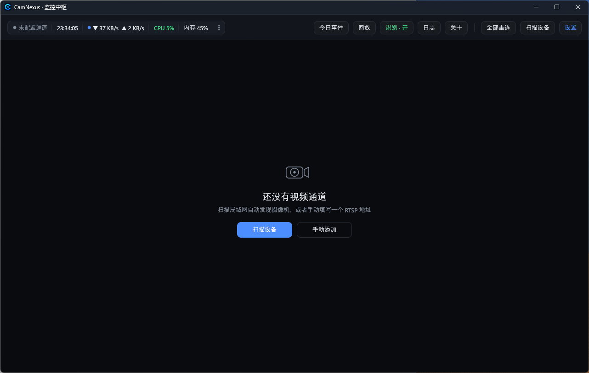
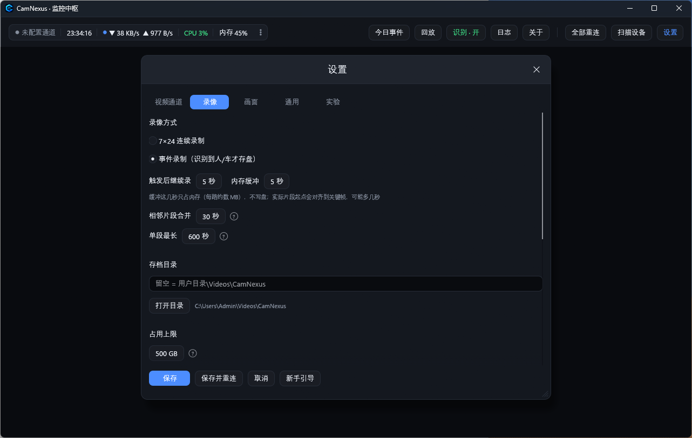
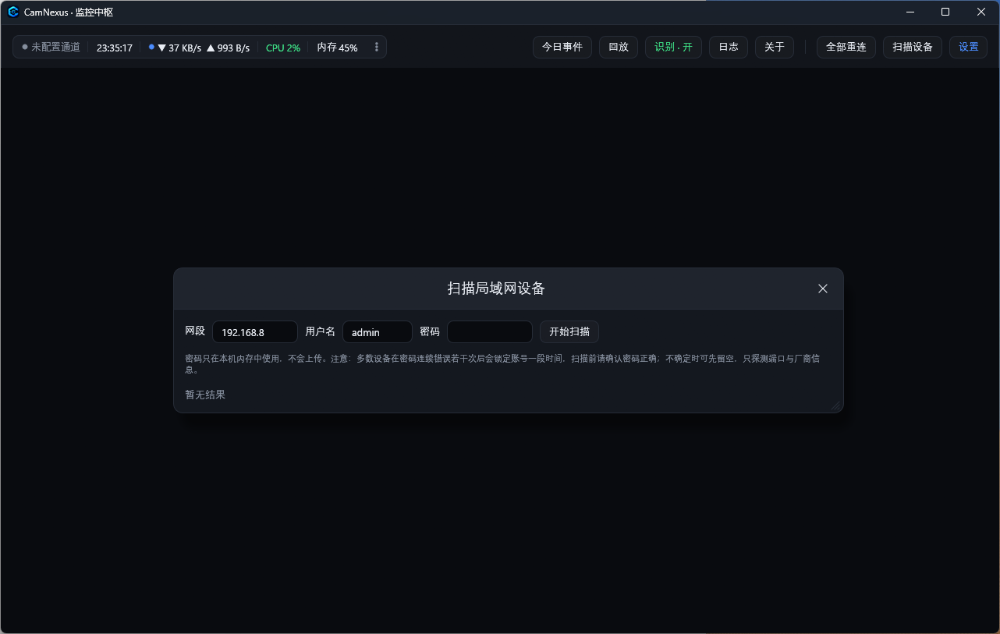
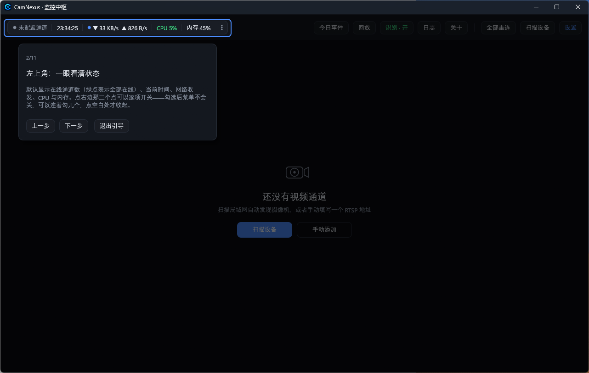

# CamNexus · 监控中枢

> 把局域网里的多台摄像机集中到一个窗口里看、录、回放。
> 为旧电脑设计——不转码、不吃内存、装完就能用。

**[English](README.en.md) | 简体中文**

---

## 这是什么

CamNexus 是一个 Windows 桌面程序，用来同时查看和录制局域网中的摄像机画面。

只要设备能提供 **RTSP 地址**（网络摄像机、录像机、手机上的摄像头 App 大多都支持），就能加进来统一管理。它不依赖厂商云服务，所有画面和录像都留在你自己的电脑里。

设计目标很明确：**让一台旧电脑直接变成监控录像机**。所以默认不转码、界面用轻量渲染、内存占用控制在百兆级。

---

## 截图

| | |
|---|---|
|  |  |
|  |  |

---

## 功能

### 监看

- **多路同屏**：通道数量不限，网格自动排布
- **全屏自由布局**：每一路可以拖动、缩放、吸附对齐，位置会记住
- **一键布局**：把散乱的画面整理成规整网格
- **单路全屏**：双击或右键把某一路铺满屏幕
- **子码流**：大画面用主码流、小画面用子码流，旧电脑也能带多路
- **声音**：任意一路可单独开声音，**与画面共用同一条连接**，不多占摄像机会话
- **硬件解码**：可选 CUDA / D3D11VA / QSV / AMF，把解码交给显卡
- **数据栏**：顶栏实时显示在线数、时间、上下行网速、处理器与内存占用，点右端的 ⋮ 勾选要显示哪几项

### 录像与回放

- **源画质录制**：直接把摄像机原始码流封装成 MP4，不重新编码，处理器几乎不干活
- **整点分段**：按通道和日期分目录，文件按整点切开，文件名精确到秒，失败重试也不会撞名
- **断网自动恢复**：网络类故障会一直重试（间隔最长 30 秒）。断电、换网、相机重启之后都能自己接上
- **只在有画面时开录**：摄像机没连上就不开始录制，不会白占重试次数，也不会留下空文件
- **容量上限**：默认 500 GB，超过后自动删最旧的；也会按磁盘剩余空间兜底，不会把盘写满
- **事件录像**：只在有人有车时录，平时不写盘；触发前后各留几秒，详见[下文](#事件录像可选)
- **回放**：内置播放窗口，按日期和通道浏览
- **抓拍快照**：一键把当前画面存成图片

### 无人值守

- **开机自启**：登录 Windows 后自动运行，写的是当前用户的启动项，不需要管理员权限
- **进程守护**：程序异常退出会被立刻拉起；正常关窗口则连守护一起退出
- **启动后自动录像**：开机即进入录像状态。画面还没连上的通道会等它上线再开录

> 守护依附于自启：只开守护不开自启，重启之后没有任何东西去拉起它，所以设置里这两项是联动的。

### 画面调整

- **旋转 / 翻转**：0° / 90° / 180° / 270°，水平、垂直翻转
- **裁剪黑边**：自动识别并裁掉画面自带的纯黑边（手机竖屏推流常见）
- **比例锁定**：锁定时只能等比缩放，解锁后可随意拉伸
- **恢复原比例**：一键把画面比例调回正常

### 发现与连接

- **局域网扫描**：自动找出同网段可能存在的摄像机和端口
- **地址探测**：尝试常见 RTSP 路径，直接给出可用地址
- **接通诊断**：显示每一路的帧率、卡顿原因、连接状态

### 界面

- 简体中文 / English 切换，**新手引导第一步就能选**，现场切完后面的讲解直接跟着变
- 深色、浅色主题
- 首次运行有 11 步新手引导，从数据栏讲到录像模式，随时能从「设置」底部重放
- 顶栏数据栏：显示哪些指标由你决定，勾选时菜单不会关，可以连着勾几项

### 实验功能（默认关闭）

- **人体 / 车辆识别**：在画面上画框标注，只标出**正在移动**的人和车——停着的车、站着不动的人不会一直占着框。
  主界面的开关会记住状态：关掉软件或崩溃后重启，识别会自动恢复到上次的开关，事件录像不会因此失效。
  需要额外下载模型，可选择用处理器或显卡，抽取频率 1–25 FPS 可调（CPU 上限 10、显卡上限 25），设置里会按本机估算占用；对老机器负担较大，所以默认不开启。
- **框和录制不是一回事**：画面上只框正在移动的目标；但事件录像的触发宽松些——人只要在场就录（站着不动也算），车和摩托必须真的在动。

---

## 运行环境

| 项目 | 要求 |
|---|---|
| 系统 | Windows 10 / 11（64 位） |
| 处理器 | 双核即可；多路 1080p 建议四核以上 |
| 内存 | 2 GB 以上 |
| 显卡 | 无要求；有独显或核显可开硬件解码降低占用 |
| 网络 | 与摄像机在同一局域网 |

**FFmpeg 不需要自己装**——首次启动会自动下载，边下边算 SHA-256，校验通过才落盘，之后跑一次 `-version` 确认能正常启动，存放在 `%LOCALAPPDATA%\CamNexus`。

> FFmpeg 由本项目以**独立进程**方式调用，不链接、不打包、不随本程序分发；它由第三方以 GPLv3 发布，版权归 FFmpeg 作者所有，源码见 [ffmpeg.org](https://ffmpeg.org)。

---

## 快速开始

1. **下载并解压**到任意目录（不要放在需要管理员权限的路径下）
2. **双击运行** `camnexus.exe`。首次启动会提示下载 FFmpeg，等它完成
3. **添加通道**：点右上角「设置」→「视频通道」→ 填摄像机地址、账号、密码
   - 不确定地址？点「扫描设备」，程序会尝试找出同网段的摄像机
4. **保存并返回**，画面就会出来

> 摄像机地址一般长这样：`rtsp://192.168.1.10:554/Streaming/Channels/101`
> 账号密码填在单独的输入框里，不要塞进地址。

---

## 界面速览

```
┌──────────────────────────────────────────────────────────────────┐
│ ● 2/2 在线 │ 10:42:07 │ ▼2.3 MB/s ⋮   今日事件 回放 … 设置       │
├──────────────────────────────────────────────────────────────────┤
│ ┌───────────┐ ┌───────────┐                                      │
│ │  通道 1   │ │  通道 2   │                                      │
│ └───────────┘ └───────────┘                                      │
└──────────────────────────────────────────────────────────────────┘
```

| 操作 | 位置 |
|---|---|
| 添加 / 修改通道 | 顶栏 → 设置 → 视频通道 |
| 录像设置、容量上限 | 顶栏 → 设置 → 录像 |
| 分辨率、解码方式、主题、语言 | 顶栏 → 设置 → 画面 / 通用 |
| 开机自启、进程守护、启动后自动录像 | 顶栏 → 设置 → 通用 → 启动与运行 |
| 数据栏要显示哪些指标 | 顶栏数据栏右端的 ⋮ |
| 查看已录的文件 | 顶栏 → 回放 |
| 单路放大 | 双击画面 |
| 进出全屏 | 右下角按钮；按 `Esc` 退出 |

### 右键菜单

在任意画面上点右键，可以对本路做以下调整：

```
画面
  ├ 旋转预览       0° / 90° / 180° / 270°
  ├ 水平翻转
  ├ 垂直翻转
  ├ 比例锁定
  ├ 裁剪黑边
  └ 恢复原比例
──────────────
视图
  ├ 一键布局
  └ 单路全屏
──────────────
操作
  ├ 抓拍快照
  └ 重新连接
```

> 旋转和翻转**只影响预览**，录像始终是摄像机原始画面。

---

## 录像与存储

| 项目 | 默认值 | 说明 |
|---|---|---|
| 保存位置 | `我的视频\CamNexus` | 可在设置里改成任意磁盘 |
| 容量上限 | 500 GB | 超出后自动删最旧的文件；设 0 表示不限制 |
| 录制方式 | 源画质（不转码） | 处理器占用接近 0，画质与摄像机一致 |
| 音频 | 开启 | 摄像机的麦克风或音轨会一起存进 MP4 |
| 分段 | 按整点 | 每小时一个文件，文件名是「日期 起始-结束」，断网后重试不会覆盖旧文件 |

录像文件按「通道 / 日期 / 时间」组织，可以直接用播放器打开，不依赖本程序。


### 事件录像（可选）

默认是 **7×24 连续录制**。也可以在「设置 → 录像 → 录像方式」切成**事件录制**：

- 相机照常连着，但画面只在**内存**里留最近几秒（默认 5 秒），不写盘
- 触发分两种情况：**人**出现在画面里就录——站在那儿不动也算；**车、摩托**这类必须真的在动（速度达到画面宽度的 8%/秒）。停着的车检测框会抖 1–2%，按「有检出就录」会整晚录个不停
- 触发前后各存几秒，相隔不到 30 秒的两段自动并成一个文件（可调，0 = 不拼）
- 单段最长 10 分钟；到点收尾，目标赖着不走也不会无休止地录
- 触发一结束就**停止写盘**，文件句柄留着等续接——空等的那几十秒不会进文件
- 片段起点对齐关键帧，所以「前 5 秒」实际可能多几秒
- 需要先启用「智能识别」。没开识别，事件录制不会触发任何录制
- 片段存在 `事件片段/日期/通道/`，**不和全天录像混在一起**；回放窗口顶部可以切换两种录像

好处是空闲时不写盘，机械盘和固态盘都省；代价是依赖识别准确率。介意漏检就用 7×24。

---

## 配套应用

### CamNexusRTSP · 把安卓手机变成摄像头

如果有闲置的安卓手机，可以装上 [CamNexusRTSP](https://github.com/oywq00008-cell/CamNexus-RTSP)：它在手机本地启动一个 RTSP 服务，把摄像头画面直接推送到局域网，不需要电脑中转，也不上传云端。

- 手机摄像头的画质通常远好于普通家用摄像头
- 输出标准 RTSP，本程序可以直接添加为一个通道
- 支持后台与锁屏持续推流、可选账号密码、端口默认 8554

> 接入方式：手机上点开始推流，把界面显示的 `rtsp://手机IP:8554/...` 填进本程序的「视频通道」即可。

---

## 日志与今日报告

日志在 `%LOCALAPPDATA%\CamNexus\logs\`，每天一个 Markdown 文件，记录：

- **录像**：开录、停止、失败
- **识别**：检出目标（类别 + 分数）并触发事件录像
- **取流**：画面卡住重连、恢复
- **设置**：改了什么（逐项对比，例如「送显分辨率: 1280×720 → 960×540」）

主界面的**「今日事件」**按钮会解析当天日志，生成一份报告：每路今天录了多久、
哪些时段检测到人或车、每段多长，并可一键打开录像目录。

每段的状态有三种：**已保存**、**进行中**（此刻正在录）、**中断**（录制被程序退出打断，
文件还在但没写完）。中途重启过程序的话，那几段会标成「中断」，不会一直挂着「进行中」。


---

## 诊断命令

出问题时可以先跑这些命令，输出比截图信息量大得多：

| 命令 | 用途 |
|---|---|
| `camnexus.exe --hw-test` | 打印处理器/显卡画像与模型推荐，用来核对推荐是否合理 |
| `camnexus.exe --event-test N` | 对第 N 路手动触发一次事件录像，验证「取流 → 缓冲 → 落盘」整条链路 |
| `camnexus.exe --detect-test 图片.jpg` | 用当前模型跑一张图，打印检出结果与耗时；加 `--gpu` 走显卡 |
| `camnexus.exe --audio-test N` | 检查第 N 路有没有音轨、有没有真的收到音频 |
| `camnexus.exe --probe rtsp://…` | 探测某个 RTSP 地址是否可用 |
| `camnexus.exe --net-test` | 打印各网卡的实时收发速率 |
| `camnexus.exe --settings` / `--fullscreen` | 直接打开设置 / 全屏启动 |

---

## 配置文件

首次运行会在程序同级目录生成 `config.json`，所有设置都保存在这里（含摄像机密码，请注意不要外传）。删掉它会恢复默认设置。

仓库里的 `config.example.json` 是一份模板，可以参考它了解各项含义。

---

## 常见问题

**没有声音？**

先在命令行跑一次 `camnexus.exe --audio-test 1`（数字是通道序号）。它会打印这一路有没有音轨、有没有真的收到音频数据，能区分"摄像机本来就没麦克风"和"取流失败"。

**摄像机连不上怎么办？**

先确认三件事：地址是否完整、账号密码是否正确、摄像机是否开启了 RTSP。海康、大华等品牌的「设备账号」和「ONVIF 账号」是两套独立账号——Web 界面能登录，不代表 RTSP 能用。

**画面是竖条，两侧或上下有黑边？**

多半是推流端把竖屏画面塞进了横屏画面里。右键开启「裁剪黑边」，再配合「旋转 90°」即可铺满。

**断电或断网之后会自己恢复吗？**

会。取流会按 1→2→4→8→10 秒逐步退避重连；录像遇到网络类错误会一直重试，间隔封顶 30 秒，相机恢复后自动续录。如果开了「开机自启 + 进程守护」，整机重启后程序也会自己回来并继续录。

**不小心开了两个程序会怎样？**

第二份会直接退出。程序用单实例锁保证只有一份在跑——否则两套取流会把摄像机的连接数占满。

**录像太占空间？**

三个方向：① 换成**事件录像**，只在有人有车时写盘，空闲时零写入；② 在摄像机或 App 里把码率调低；③ 录制时选更低的画质档位（会重新编码，处理器占用上升）。

**开了事件录像，却什么都没录下来？**

按顺序查三件事：① 设置 → 实验功能里「智能识别」是否启用——没开识别，事件录像不会触发；② 识别模型是否已下载完成；③ 目标是不是太小，画面宽度 8% 以下基本检不出，把送显分辨率调低能让远处目标变大。另外**车辆必须真的在动**，停着的车不触发。

**事件片段为什么只有十几秒？**

事件录制只保存触发窗口内的画面，触发一结束就停止写盘，空等的时间不进文件。想要更长，可以在「设置 → 录像」里调大「触发后继续录」，或者恢复 7×24 连续录制。

**「今日事件」里某段显示「中断」是什么意思？**

那段录制被程序退出打断了（关机、崩溃、手动结束进程），文件还在但没写完——能播到断点，只是没有结尾。经常出现的话，先看是不是被安全软件结束了进程。

**识别框为什么只框移动的目标？**

框和录制是两套判定。画面上只标注**正在移动**的目标，免得停着的车一直占着框；但事件录像的触发更宽松——人只要在场就录，站着不动也算。所以「人在录、却没有框」是正常的。

**支持哪些摄像机？**

只要提供标准 RTSP 地址就行。海康、大华、宇视、TP-LINK 等通用品牌都可用；安卓手机可以装 [CamNexusRTSP](https://github.com/oywq00008-cell/CamNexus-RTSP) 之类的 App 当作摄像头。

**需要联网吗？**

首次下载 FFmpeg 时需要；要用识别功能的话，下载模型时也需要。之后完全离线运行。

**升级到新版本，原来的配置和录像还在吗？**

都在。用新的 `camnexus.exe` 覆盖旧的即可，`config.json` 和录像目录都不会动，新增的配置项自动取默认值。旧的事件片段在「今日事件」里时长按估算显示（早期日志没记真实秒数），新录的才精确。

**杀毒软件报毒？**

程序没有购买代码签名证书，部分杀毒软件会对未签名程序误报。可以从源码自行编译，或把程序加入白名单。

---

## 第三方组件

本程序**不打包**下列组件，但它们会被用到，各自的许可与来源如下：

| 组件 | 用途 | 许可 | 获取方式 |
|---|---|---|---|
| FFmpeg | 取流、解码、封装 | GPLv3（gyan.dev 构建） | 首次启动自动下载；可用环境变量 `CAMNEXUS_FFMPEG_MIRROR` 指定镜像 |
| DirectML.dll | 显卡推理（ONNX Runtime 的 DirectML 后端） | 微软随 Windows SDK 提供的可再分发组件 | 随程序一起分发 |
| 识别模型（可选） | 人体 / 车辆识别 | YOLOX：Apache-2.0；YOLO26：AGPL-3.0 | 用户在软件里自行下载 |

**关于识别模型**：YOLO26 系列由 [Ultralytics](https://ultralytics.com) 发布，采用 AGPL-3.0。
本程序不打包、不镜像、也不分发这些模型；下载由你本人发起，而且必须先在弹窗里阅读许可须知并勾选同意，
否则既不能下载也不能启用识别。把这类模型用于闭源商业产品或服务，需向 Ultralytics 购买商业授权。

模型文件内部自带许可证字段（`license = AGPL-3.0 License`），可以自行核对。
不想用随时可以在设置里删除，文件位于 `%LOCALAPPDATA%\CamNexus\models`。

上面这张表在程序的**「关于」**窗口里也有一份，装的什么版本、当前用的哪个模型，一眼能看到。

---

## 从源码构建

需要 Rust **1.88+**、Visual Studio Build Tools（提供 MSVC 链接器）和 Windows SDK（提供 `rc.exe`，用于嵌入图标）。

```bash
cargo build --release     # 产物：target/release/camnexus.exe
cargo test                # 单元测试
```

Windows SDK 缺失时只会告警，程序仍可构建（只是没有图标和版本信息）。仓库只包含构建与运行所需的内容。

---

## 许可证

[MIT](LICENSE) © 2026 oywq0008-cell

程序本身不包含也不分发 FFmpeg，由用户机器首次运行时自行下载。

本程序通过命令行调用 FFmpeg（独立进程，不链接其库），使用的是 GPLv3 构建。FFmpeg 的版权归其作者所有，以 GPLv3 发布，源码见 [ffmpeg.org](https://ffmpeg.org)。

> 如果你把本程序和下载好的 `ffmpeg.exe` 一起打包转发给别人，**转发行为本身**需要遵守 GPLv3（附许可证全文并提供源码获取方式）。建议直接分发本程序，让接收方自行启动下载。

### 识别模型

模型是独立的数据文件，不链接进程序，也不随本程序分发，由使用者自行下载：

| 模型 | 许可 | 说明 |
|---|---|---|
| YOLOX-s | **Apache-2.0** | 宽松许可，商用友好；保留版权与许可声明即可 |
| YOLO26n / l / x | **AGPL-3.0** | 由 [Ultralytics](https://ultralytics.com) 发布；用于闭源商业产品或服务需向其购买商业授权 |

- 模型的著作权归各自作者，本程序只负责加载与推理
- 首次下载前必须在弹窗里阅读许可并勾选同意，否则既不能下载、也不能启用识别
- 模型文件内自带 `license` 字段，可以自行核对
- AGPL 对**通过网络对外提供服务**另有源码开放要求。本程序只把模型当数据文件加载，不链接 Ultralytics 的代码；若你的场景涉及对外提供识别服务，请按 AGPL 原文评估义务，必要时咨询法律意见
