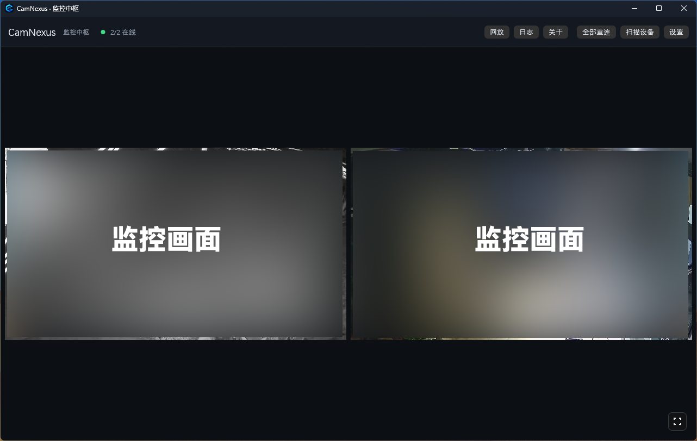

# CamNexus · 监控中枢

> 把局域网里的多台摄像机集中到一个窗口里看、录、回放。
> 为旧电脑设计——不转码、不吃内存、装完就能用。

**[English](README.en.md) | 简体中文**

---

## 这是什么

CamNexus 是一个 Windows 桌面程序，用来同时查看和录制局域网中的摄像机画面。

只要设备能提供 **RTSP 地址**（网络摄像机、录像机、手机上的摄像头 App 大多都支持），就能加进来统一管理。它不依赖厂商云服务，所有画面和录像都留在你自己的电脑里。

设计目标很明确：**让一台旧电脑直接变成监控录像机**。所以默认不转码、界面用轻量渲染、内存占用控制在百兆级。



---

## 功能

### 监看

- **多路同屏**：通道数量不限，网格自动排布
- **全屏自由布局**：每一路可以拖动、缩放、吸附对齐，位置会记住
- **一键布局**：把散乱的画面整理成规整网格
- **单路全屏**：双击或右键把某一路铺满屏幕
- **子码流**：大画面用主码流、小画面用子码流，旧电脑也能带多路
- **声音**：任意一路可单独开声音
- **硬件解码**：可选 CUDA / D3D11VA / QSV / AMF，把解码交给显卡

### 录像与回放

- **源画质录制**：直接把摄像机原始码流封装成 MP4，不重新编码，处理器几乎不干活
- **分段保存**：按通道和日期分目录，文件名带时间
- **容量上限**：默认 500 GB，超过后自动删最旧的；也会按磁盘剩余空间兜底，不会把盘写满
- **回放**：内置播放窗口，按日期和通道浏览
- **抓拍快照**：一键把当前画面存成图片

### 画面调整

- **旋转 / 翻转**：0° / 90° / 180° / 270°，水平、垂直翻转
- **裁剪黑边**：自动识别并裁掉画面自带的纯黑边（手机竖屏推流常见）
- **比例锁定**：锁定时只能等比缩放，解锁后可随意拉伸
- **恢复原比例**：一键把画面比例调回正常

### 发现与连接

- **局域网扫描**：自动找出同网段可能存在的摄像机和端口
- **地址探测**：尝试常见 RTSP 路径，直接给出可用地址
- **接通诊断**：显示每一路的帧率、卡顿原因、连接状态

### 界面

- 简体中文 / English 切换
- 深色、浅色主题
- 首次运行有新手引导

### 实验功能（默认关闭）

- **人体 / 车辆识别**：在画面上画框标注。需要额外下载模型，可选择用处理器或显卡；对老机器负担较大，所以默认不开启。

---

## 运行环境

| 项目 | 要求 |
|---|---|
| 系统 | Windows 10 / 11（64 位） |
| 处理器 | 双核即可；多路 1080p 建议四核以上 |
| 内存 | 2 GB 以上 |
| 显卡 | 无要求；有独显或核显可开硬件解码降低占用 |
| 网络 | 与摄像机在同一局域网 |

**FFmpeg 不需要自己装**——首次启动会自动下载并校验，存放在 `%LOCALAPPDATA%\CamNexus`。

---

## 快速开始

1. **下载并解压**到任意目录（不要放在需要管理员权限的路径下）
2. **双击运行** `camnexus.exe`。首次启动会提示下载 FFmpeg，等它完成
3. **添加通道**：点右上角「设置」→「视频通道」→ 填摄像机地址、账号、密码
   - 不确定地址？点「扫描设备」，程序会尝试找出同网段的摄像机
4. **保存并返回**，画面就会出来

> 摄像机地址一般长这样：`rtsp://192.168.1.10:554/Streaming/Channels/101`
> 账号密码填在单独的输入框里，不要塞进地址。

---

## 界面速览

```
┌─────────────────────────────────────────────────┐
│ CamNexus  2/2 在线     回放 日志 关于 …  设置   │  ← 顶栏
├─────────────────────────────────────────────────┤
│ ┌───────────┐ ┌───────────┐                     │
│ │  通道 1   │ │  通道 2   │                     │  ← 画面区
│ └───────────┘ └───────────┘                     │
└─────────────────────────────────────────────────┘
```

| 操作 | 位置 |
|---|---|
| 添加 / 修改通道 | 顶栏 → 设置 → 视频通道 |
| 录像设置、容量上限 | 顶栏 → 设置 → 录像 |
| 分辨率、解码方式、主题、语言 | 顶栏 → 设置 → 画面 / 通用 |
| 查看已录的文件 | 顶栏 → 回放 |
| 单路放大 | 双击画面 |
| 进出全屏 | 右下角按钮；按 `Esc` 退出 |

### 右键菜单

在任意画面上点右键，可以对本路做以下调整：

```
画面
  ├ 旋转预览       0° / 90° / 180° / 270°
  ├ 水平翻转
  ├ 垂直翻转
  ├ 比例锁定
  ├ 裁剪黑边
  └ 恢复原比例
──────────────
视图
  ├ 一键布局
  └ 单路全屏
──────────────
操作
  ├ 抓拍快照
  └ 重新连接
```

> 旋转和翻转**只影响预览**，录像始终是摄像机原始画面。

---

## 录像与存储

| 项目 | 默认值 | 说明 |
|---|---|---|
| 保存位置 | `我的视频\CamNexus` | 可在设置里改成任意磁盘 |
| 容量上限 | 500 GB | 超出后自动删最旧的文件；设 0 表示不限制 |
| 录制方式 | 源画质（不转码） | 处理器占用接近 0，画质与摄像机一致 |
| 音频 | 开启 | 摄像机的麦克风或音轨会一起存进 MP4 |

录像文件按「通道 / 日期 / 时间」组织，可以直接用播放器打开，不依赖本程序。

---

## 配套应用

### CamNexusRTSP · 把安卓手机变成摄像头

如果有闲置的安卓手机，可以装上 [CamNexusRTSP](https://github.com/oywq00008-cell/CamNexus-RTSP)：它在手机本地启动一个 RTSP 服务，把摄像头画面直接推送到局域网，不需要电脑中转，也不上传云端。

- 手机摄像头的画质通常远好于普通家用摄像头
- 输出标准 RTSP，本程序可以直接添加为一个通道
- 支持后台与锁屏持续推流、可选账号密码、端口默认 8554

> 接入方式：手机上点开始推流，把界面显示的 `rtsp://手机IP:8554/...` 填进本程序的「视频通道」即可。

---

## 常见问题

**摄像机连不上怎么办？**

先确认三件事：地址是否完整、账号密码是否正确、摄像机是否开启了 RTSP。海康、大华等品牌的「设备账号」和「ONVIF 账号」是两套独立账号——Web 界面能登录，不代表 RTSP 能用。

**画面是竖条，两侧或上下有黑边？**

多半是推流端把竖屏画面塞进了横屏画面里。右键开启「裁剪黑边」，再配合「旋转 90°」即可铺满。

**录像太占空间？**

默认存的是摄像机原始画质。想省空间，可以在摄像机或 App 里调低码率，或者录制时选择更低的画质档位（会重新编码，处理器占用上升）。

**支持哪些摄像机？**

只要提供标准 RTSP 地址就行。海康、大华、宇视、TP-LINK 等通用品牌都可用；安卓手机可以装 [CamNexusRTSP](https://github.com/oywq00008-cell/CamNexus-RTSP) 之类的 App 当作摄像头。

**需要联网吗？**

只有首次下载 FFmpeg 时需要。之后完全离线运行。

**杀毒软件报毒？**

程序没有购买代码签名证书，部分杀毒软件会对未签名程序误报。可以从源码自行编译，或把程序加入白名单。

---

## 配置文件

首次运行会在程序同级目录生成 `config.json`，所有设置都保存在这里（含摄像机密码，请注意不要外传）。删掉它会恢复默认设置。

仓库里的 `config.example.json` 是一份模板，可以参考它了解各项含义。

---

## 从源码构建

需要 Rust **1.88+**、Visual Studio Build Tools（提供 MSVC 链接器）和 Windows SDK（提供 `rc.exe`，用于嵌入图标）。

```bash
cargo build --release     # 产物：target/release/camnexus.exe
cargo test                # 单元测试
```

Windows SDK 缺失时只会告警，程序仍可构建（只是没有图标和版本信息）。仓库只包含构建与运行所需的内容。

---

## 许可证

[MIT](LICENSE) © 2026 oywq0008-cell

程序本身不包含也不分发 FFmpeg，由用户机器首次运行时自行下载。
